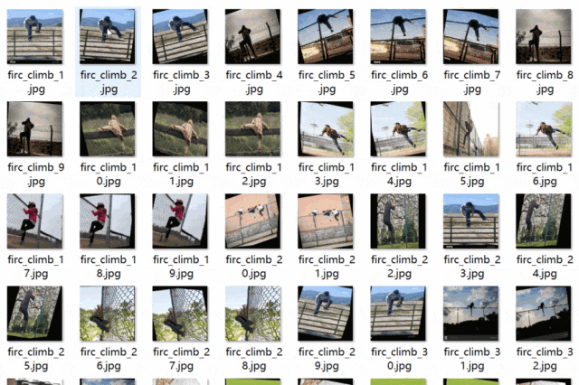
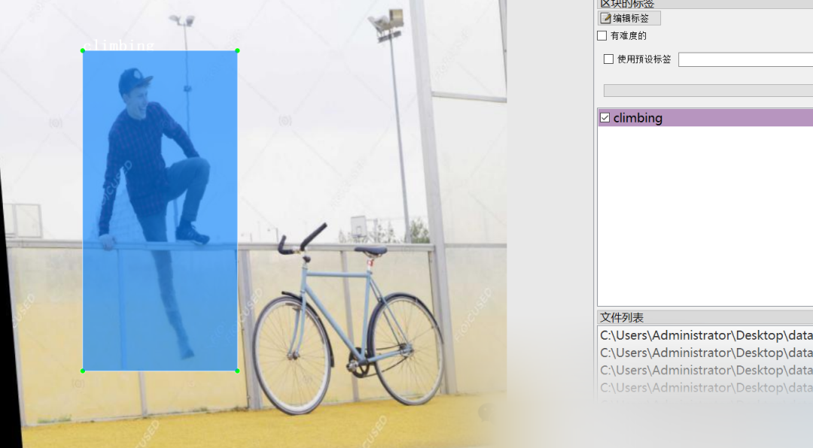

# [Dataset] [Object Detection] Over-Barrier Behavior Detection Dataset VOC+YOLO format with 512 images in 1 category

Dataset format: Pascal VOC format + YOLO format (txt file without split path, only containing jpg images and corresponding VOC format xml files and yolo format txt files)
Number of images (number of jpg files): 512
Number of annotations (number of xml files): 512
Number of annotations (number of txt files): 512
Number of annotation categories: 1
Annotation category name: ["climbing"]
Number of boxes per category:
climbing box count = 599
Total box count: 599
Labeling tool used: labelImg

Image Preview:

Annotation example:

## Payment

Here is a pay link on Stripe ( https://buy.stripe.com/3cs8yP7sY87d0vu9AB ). Please contact me lonlonago@foxmail.com after funding $89, and I will send you a complete data files , thank you!

